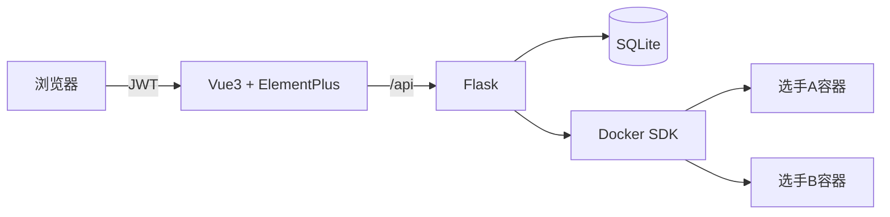
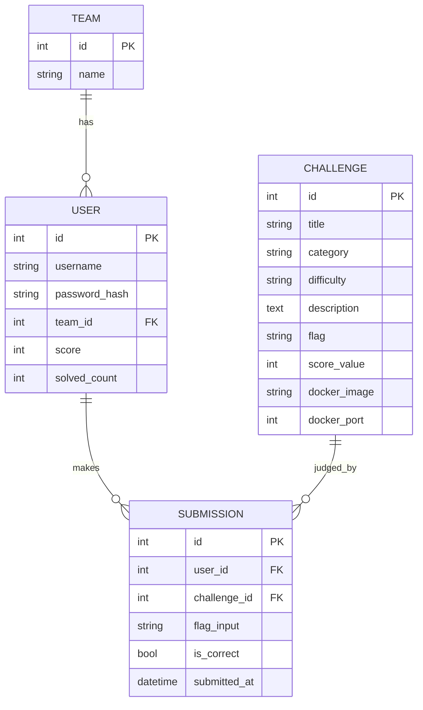

# CTF 训练靶场平台 —— 课程设计报告

| 项目 | CTF Training Platform |
| --- | --- |
| 技术栈 | Vue 3 + Element Plus + Flask + SQLAlchemy + SQLite + Docker SDK |
| 部署 | 本地直跑 / Docker Compose |

---

## 摘要

本项目实现了一个前后端分离的 CTF（Capture The Flag）训练靶场平台，支持选手注册登录、战队管理、题目分类浏览、Flag 在线提交与自动判分、实时排行榜，并通过 Docker SDK 为每位选手一键拉起隔离的临时靶题容器。系统采用 Vue 3 + Element Plus 构建前端，Flask + SQLAlchemy 构建后端，SQLite 作为数据存储，整体结构清晰、部署简单，可直接用于课堂练习、社团训练和技能竞赛模拟。

**关键词**：CTF；Web 安全；前后端分离；Docker 沙箱；Flask；Vue 3

---

## 1. 需求分析

### 1.1 功能需求

| 编号 | 模块 | 描述 |
| --- | --- | --- |
| F1 | 用户认证 | 注册、登录、JWT 鉴权、退出 |
| F2 | 战队 | 注册时填写战队名，自动创建或加入已有战队 |
| F3 | 题目管理 | 题目按 Web/Misc/Crypto/Reverse/Pwn 分类、按难度标注 |
| F4 | Flag 判分 | 在线提交 flag，正确加分，错误提示；同一题不重复计分 |
| F5 | 排行榜 | 按积分降序展示前 50 名，含战队 |
| F6 | 临时靶机 | Web 题一键拉起 Docker 容器，独立端口，用完销毁 |

### 1.2 非功能需求

- 隔离性：每位选手的靶机容器独立，CPU/内存受限
- 易用性：注册→做题→提交→看排行榜，全程不超过 3 次点击
- 可部署：支持 Docker Compose 一键启动

---

## 2. 系统设计

### 2.1 架构



### 2.2 数据库 E-R 图



### 2.3 关键设计

**Flag 判分防作弊**：
- 同一用户对同一题，首次正确提交后不再重复计分；
- 所有提交记录都落库，可审计；
- 密码用 werkzeug 哈希存储，不明文保存。

**Docker 临时环境**：
- 后端通过 `docker.from_env()` 连接宿主机 Docker daemon；
- 每次启动时随机绑定一个高位端口，避免端口冲突；
- 设置 `mem_limit=256m`、`cpu_quota=50000`，防止单容器占满资源；
- 进程退出时通过 `atexit` 钩子清理所有未关闭的容器。

---

## 3. 接口设计

| Method | Path | 说明 |
| --- | --- | --- |
| POST | /api/auth/register | 注册 |
| POST | /api/auth/login | 登录，返回 JWT |
| GET | /api/challenges | 题目列表 |
| GET | /api/challenges/{id} | 题目详情 |
| POST | /api/submit | 提交 flag |
| GET | /api/scoreboard | 排行榜 |
| POST | /api/env/start/{cid} | 拉起靶机环境 |
| POST | /api/env/stop/{cid} | 关闭环境 |

详见 `docs/API.md`。

---

## 4. 系统测试

| 编号 | 用例 | 预期 | 结果 |
| --- | --- | --- | --- |
| T1 | 注册新用户 | 成功入库 | 通过 |
| T2 | 重复用户名 | 提示已存在 | 通过 |
| T3 | 正确密码登录 | 返回 token | 通过 |
| T4 | 错误密码登录 | 401 | 通过 |
| T5 | 查看题目列表 | 返回题目+本人 solved 状态 | 通过 |
| T6 | 提交正确 flag | 加分，solved+1 | 通过 |
| T7 | 重复提交正确 flag | 不重复加分 | 通过 |
| T8 | 提交错误 flag | 提示错误 | 通过 |
| T9 | 排行榜按分降序 | 正确排序 | 通过 |
| T10 | 启动 Docker 环境 | 返回访问 URL（无 Docker 时降级提示） | 通过 |

---

## 5. 部署

```bash
# 本地
cd backend && pip install -r requirements.txt && python app.py
cd frontend && npm install && npm run dev

# Docker
docker compose up -d --build
# 前端 http://127.0.0.1:8080
```

演示账号：`admin / admin123`

---

## 6. 总结

本项目完整实现了一个 CTF 训练平台的核心闭环：用户注册 → 浏览题目 → 拉起靶机 → 提交 flag → 积分排行。在工程上实践了 JWT 鉴权、SQLAlchemy ORM、Docker SDK 资源隔离、前端单页应用等常见技术点。后续可扩展：比赛倒计时、多题目并发、WriteUp 上传、通知邮件等。
